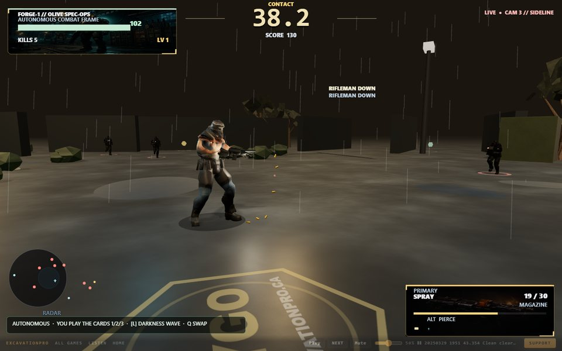
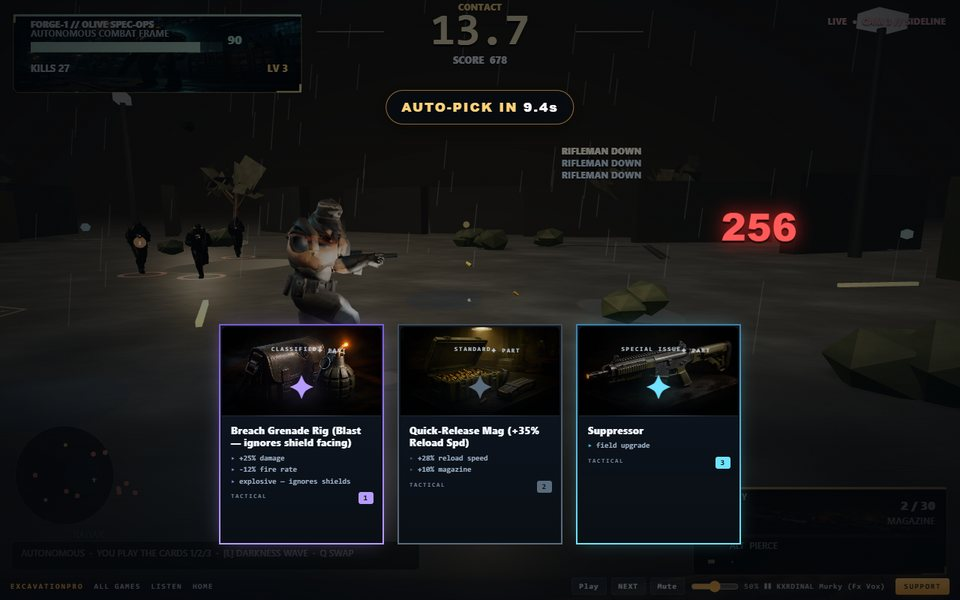
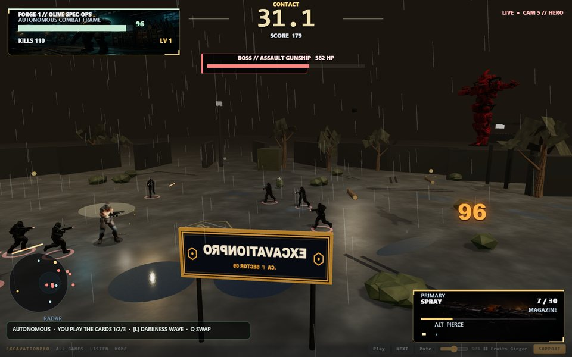

# Combat pass — 2026-10-30

Full play-and-test pass on the fighting portion of Forge Smoke (the start page and the manager
were reported as good, and are unchanged in behaviour). Everything below was measured on the
preview server with Playwright on the **real GPU** (ANGLE / D3D11, RTX 4060 Ti), not swiftshader.

## Evidence

| Check | Command | Result |
|---|---|---|
| Unit / syntax / assets / regress | `python tools/gate.py` | `UNIT OK 349`, `REGRESS OK … errors=0` |
| Play-loop regression | `node tools/combat.mjs` | **COMBAT OK 16/16 checks** |
| 60 s autonomous play (GPU) | `playtest session` | 0 page errors, 60 kills, 148 m moved, worst "wanted to move but did not" window **0.0 s** |
| Frame timing (GPU, 45 s) | injected rAF + longtask observer | median **16.7 ms**, p95 **16.8 ms**, launch long task **157 ms** (was **834–1016 ms**) |
| Start menu / manager | screenshots | both open and render; no regression |

## Third pass (same day) — measured the fight, then tuned it

New tool: `node tools/fightlab.mjs` drives the real loop and reports TTK per weapon style, incoming
fire volume/hit rate, and whether each enemy rig is actually animating.

| Measurement | Result |
|---|---|
| TTK, rifleman at 9 m | spray 0.83 s · pierce 0.73 · cone 0.62 · burst 2.16 · beam 2.10 · spinup 0.42 · rail 0.10 · arc 1.55 |
| Enemy rigs animating | every rigged type moves a sampled hand bone 0.4-1.8 units over 0.7 s (drone is a rotor mesh, mortar is a static emplacement) |
| Impact effects | muzzle flash lands 0.13 m past the barrel tip, tracer starts at the muzzle, **0 impact effects existed before this pass** |
| Incoming fire (4 riflemen, stationary) | 0 shots before the fix; 5 shots / 3 hits / 18 damage in 3 s after |

Fixes:
- **`fx.js` was dead code** — `fxController` was created and never called, so hits had no spark.
  Added a 28-point 3D impact-spark pool (4-5 sparks per hit, 10 + a ground ring on a kill).
- Casing pool was **6**; an SMG burst recycled the whole pool. Now 24.
- The early shooter ramp started at **12 %**, so a four-rifleman squad could fire zero rounds
  (measured). 35 % at t=0, 85 % by ~1.5 min.
- Card tray scrim + the darkness wave together left the screen nearly black; the tray is much
  lighter now and the fight stays visible while choosing.
- Boss gate 75 s / 75 kills -> **65 s / 60 kills** (the harsher ramp shortened the median run; the
  boss is a mid-run event again). Measured run: boss at ~65 s, dead at 78 s with the gunship on
  156/900 — a genuine "so close" finish.
- Regression: `combat.mjs` now also asserts every hit spawns an impact burst (24/24 checks).

## Second pass (same day) — the arena was the wrong lever

The first pass shrank the play radius from 54 m to 30 m to make the fight readable. That was a
mistake and it broke the maps: the fixture ring (17-33 m) landed on the boundary, the fighter got
clamped inside his own cover, and because spawns are measured from the PLAYER a boss could appear
20 m outside the wall. The radius is now **54 m again** and the spatial rules are enforced properly:

| Bug | Cause | Fix |
|---|---|---|
| Boss hovered in place | `updateGunship()` returned `{type:"strafe"}` and never wrote a velocity | holds a 14-24 m ring at `strafeSpeed`, verified **27 m in 8 s** |
| Mech froze at range | velocity forced to 0 inside 25 m | keeps a firing line (close to 14 m, open to 9 m, else strafes) |
| Enemies outside the ring | spawn offset from the player, unclamped | clamped to `arenaRadius - 4`, min 9 m from the player; walkers clamped to the deck |
| Fighter "stuck on every edge" | head-on prop contact cancelled the whole step; hard radial clamp with no slide | **contact slide** (project velocity onto the surface tangent) + **rim slide**; `tools/traverse.mjs`: 5/5 legs, 0 stalls in the open |
| Empty 33-50 m band | map cover only reached 33 m | outer-ring containers/barriers on all three maps (validated 17-52 m) |
| Edge was a black void | 4.6 m wall at 56 m + flat black sky | 8 m wall, lit rail on the inner face, gradient sky dome |
| Airdrop **froze the card system** | the crate set `cardPickWindow` with no tray/timer, then auto-picked an empty level-up queue and returned early — no card could ever open again | real 2-card window, drawer/pick routed to `beatDirector.pickAirdrop`, window always closes; crate no longer re-spawns every frame |
| Airdrop cards nameless | `rollAirdropOptions` never set `name` | named weapon/part cards; crate upgrades the ACTIVE weapon |
| Six of eight archetypes never seen | beat rosters were rifleman-only until 158 s | roster ramp: spotter @0 s, sapper @35 s, shieldbearer/drone @70 s, mortar @128 s |
| Spotter had no ability | `state.painted` was set by nobody and read by nobody | a **connected** sniper round paints (+15 % incoming, tighter enemy fire, HUD chip); ~26 % uptime |
| Texture count climbed every spawn | every enemy rig cloned its materials and re-baked 3 textures | per-(type,tint) material cache |
| `THREATS` label | it printed the kill count | `KILLS`; boss bar only for the real boss |

Verification for this pass: `node tools/combat.mjs` **23/23**, `node tools/traverse.mjs` **5/5**,
`python tools/gate.py` green, 80 s run: 5 archetypes + boss, airdrop fires, 0 errors.

## What was actually broken, and why

### 1. The arena was a black void (the root of "I can't see the fight")
- `ARENA_LIGHTING` exposure 1.24–1.30 with hemisphere 0.62–0.92 and `FogExp2` density 0.028–0.034.
  At 25–30 m the fog had eaten 60–65 % of the frame and the ground albedo (`#1a1d22`) was near
  black, so enemies 20 m out were invisible and the deck read as empty space.
- **No `scene.environment`**: every `MeshStandardMaterial` with metalness ≥ 0.5 (the rifle, enemy
  armour, steel props) had nothing to reflect and rendered black.
- The breach/yard floodlights sat at **x = ±40 m with an 18 m radius** — outside the arena.
- There was no perimeter: a 240 m plane fading to fog, with 5–12 props total.

Fixed: procedural equirect environment (PMREM, one texture, zero draw calls), exposure 1.52–1.55,
hemisphere 1.15–1.3, sun 2.3–2.5, fog 0.013–0.019, lighter deck palette, floodlights moved over the
playing surface (distance 28–36 m), and a 26-segment wall ring + four light towers at r = 34 m
(2 InstancedMeshes + 8 meshes). The arena radius went 54 → 30 m and enemy spawns 18–48 → 13–26 m,
so the fight happens in the lit middle instead of the dark edge.

### 2. The gun was not in the operator's hands
- The weapon was parented near the **right hand bone of a Mixamo idle/run clip** whose arms hang at
  the hips, and `updateOperatorAnimation` then slerped the weapon's quaternion to the **soldier**
  quaternion every frame — fighting the aim code that writes `gunPivot.rotation.y`. The result was a
  black stick at the hip pointing wherever the body faced.
- The gun metal was the shared world steel (metalness 0.8, no environment) — black on black.

Fixed: the weapon lives at a fixed chest anchor (`WEAPON_ANCHOR 0.12, 1.56, 0.28`) aimed by the
game's yaw/pitch, and both arms are solved with a **two-bone analytic IK** (shoulder → elbow → hand)
onto the pistol grip and foregrip every frame after the animation mixer. The gun gets its own lighter
alloy (`metalness 0.62`, `envMapIntensity 1.6`) so it reads at 5–10 m. The character's arms are no
longer posed by guessed Euler values (that function used to T-pose every enemy rig as well).

### 3. Enemy rigs were abstract sculptures
- Height normalisation was missing: the same role gear was bolted onto rigs that arrived at
  1.3–2.7 m, so the shieldbearer's 1.78 m riot shield floated in front of a 0.8 m robot, and the
  spotter wore a traffic cone.
- `tintClonedRig` treated any material whose name contained `"black"` as an **eye**, painting whole
  bodies with `emissive` at 1.4–1.8. Enemies read as glowing red/magenta blobs.
- `applyTwoHandedRiflePose` (hard-coded Euler values for one skeleton) was applied to every rigged
  enemy, producing arms-out poses on the others.

Fixed: every humanoid rig is fitted to a target silhouette height (1.78–1.88 m, mech 3.1 m), tinted
deterministically dark with no emissive guesswork, the spotter's cone hood and cloak slab are gone,
the riot shield is 1.16 × 1.34 m and held in front of the body (where the front-arc damage gate is),
and the arm override is removed (clips own the arms).

### 4. Freezing and sticking
- **Launch stall**: `startRun` rebuilt the whole arena (procedural props + textures + materials) and
  re-cloned the operator's materials on every launch. Measured long tasks of **834 ms and 780 ms**
  at run start. Fixed with a map-id cache for prop rebuilds, a skin-id cache for the operator, and a
  menu-time prewarm that builds one of each enemy body below the deck and calls `renderer.compile`
  once. Launch long task is now **157 ms** and steady state is 60 fps (p99 16.8 ms).
- **Camera crawl**: the broadcast camera was capped at `min(0.08, dt*2.5)` m/frame (4.8 m/s) with a
  0.6 s follow time constant, so a shot change could take 4 s to arrive while the fighter walked out
  of frame; the float offset was added *after* the blend and left the camera ~1.8 m high.
- **Sticking body**: the autopilot held position for 1.35–2.7 s at a time (advance 1.9–2.5 s), which
  on a 30 m arena reads as a frozen fighter. Holds are now 0.55–1.15 s, advance beats 0.75–1.2 s.
  Longest "wants to move but does not" window measured: **0.0 s** (was 2.5–3 s).
- Mortars, mechs, gunships and sappers were subject to the **rifle-carrier shooter ramp** (12 % armed
  at t = 0), so 88 % of mortars could never fire their only weapon. They are now always armed.

### 5. Combat mechanics that were wrong
- **Boss could never spawn** when the body cap was reached (`spawn()` returned null, `bossSpawned`
  was still set). Boss spawns are forced past the cap now. The difficulty budget (8 + 3.2/min, cap
  400) also overwrote the 20-body ceiling — capped at the hard cap.
- **Mortar shells and sapper charges** resolved instantly against the distance to the *enemy*, so a
  shell could only hurt you if you stood next to the mortar. They now schedule a ground-positioned
  blast with a fuse, radius and telegraph ring, and detonate where they land.
- **Weapon cards did nothing** in autonomous play: the card filled the inactive slot and the pilot
  never presses Q. A weapon card now replaces the active weapon and rebuilds it on the rig.
- **HUD** called the kill count `THREATS`, showed the boss bar for *any* mech/gunship, and the
  darkness banner sat on top of both. The kill feed moved out of the damage-number lane.
- **Dead enemies** were still valid targets for one frame; `findNearest` now skips `hp <= 0`.
- **Camera framing**: the camera never tipped up, so an assault gunship at 6.4 m could be at 372 HP
  and completely off screen. Aerial targets now get a perpendicular two-subject frame.
- Brand boards had no camera occlusion (a hero shot could sit inside one) — they now have a
  camera-only blocker volume.

## Not verified / left open
- Not tested in Firefox/Safari/mobile.
- The two-hand IK grip is approximate: hands land on the grips, but finger curl is not solved.
- The gunship model reads as a red mass at altitude; it is visible and framed, not pretty.
- Manual play was smoke-tested (W moves 10.4 m in 1.6 s) but not played for a full run.
- Browser matrix: Chromium (GPU + swiftshader) only.

## Shipped

| Target | Ref | Verified |
|---|---|---|
| Source repo `DeepSeekOracle/forge-smoke` | `master` + `main` @ `b4b07a6` | passes `tools/combat.mjs` 24/24 (three consecutive runs) + `tools/traverse.mjs` 5/5 |
| Live site `https://excavationpro.ca/games/forgesmoke/` | `deepseekoracle/excavationpro-ca` @ `53fb67f` | Pages build `built`; page serves `?v=202610326u`; live `traverse.mjs` 5/5; **live full run cleared the arena** — gunship boss killed (paid), 99 kills, 5 cards, 5 talent points, results at 1:52, 0 errors |

`main` on the source repo was a separate 2026-10-29 snapshot with an unrelated history. It is now
merged into `master` with `-s ours --allow-unrelated-histories`, so both branches carry this tree and
the snapshot commit stays an ancestor (nothing was force-pushed).
